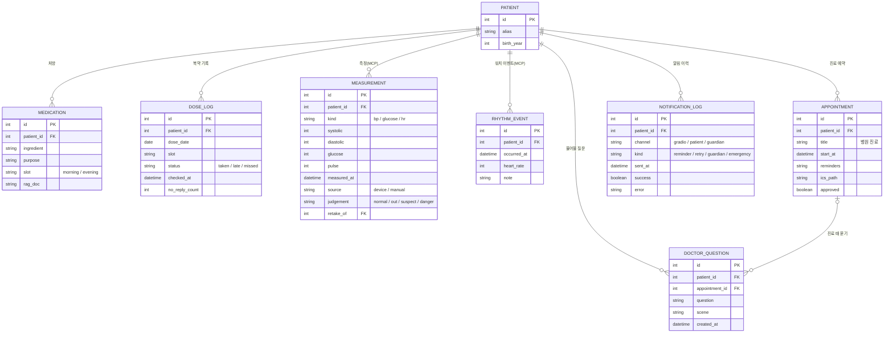

# 결정 사항 정리 — 만성질환자 복약·측정 기록 에이전트

- 과목: 생성형AI활용프로그래밍 기말 팀프로젝트
- 팀원: 안민영, 권현진
- 발표: 2026-12-10 (발표 10분 + 실시간 시연)
- 정리일: 2026-11-20
- 기준 문서: `시나리오.md`(하루 시나리오), `기획서.md`(11/13 작성). 이 문서와 기획서가 다르면 **이 문서가 최신**이다.

---

## 1. 이번에 바뀐 것 (기획서 대비)

| 항목 | 기획서(11/13) | 현재 결정 |
|---|---|---|
| LLM | Ollama `qwen3:8b` | **Gemini 3.8 Flash** (`gemini-3.8-flash`, API) |
| 캘린더 등록 | 언급 없음 | `.ics` 파일 생성 + DB 저장 (구글 캘린더 API는 여유 있을 때만) |
| 진료 때 물어볼 질문 | 리포트에만 포함 | 대화 중 저장하는 도구 `save_doctor_question` 추가 |
| 복약 상태 | 복용 / 놓침 | 복용 / **늦게 복용** / 놓침 |
| 불규칙 리듬 | 심박 도구에 포함 | 별도 테이블 `rhythm_event`로 기록만 |

---

## 2. 기술 스택

| 계층 | 선택 | 이유 (시나리오 장면) |
|---|---|---|
| LLM | Gemini 3.8 Flash (`langchain-google-genai`) | 도구 선택 품질과 응답 속도 |
| 에이전트 루프 | 수업 3장 `run_agent`(async) + `NEED_APPROVAL` + `max_iters` | ⓪ 캘린더 등록 승인, 발표 때 코드 설명이 쉬움 |
| 도구 호출 | LangChain `@tool` | ② 용량 질문 저장, ⑤ 복약 조회·중복 차단, ⑨ 리포트 |
| RAG | `bge-m3` + FAISS + 점수 임계값, 출처·쪽수 표시 | ④ 자몽주스, ⑤ 두 배 복용 금지 근거 |
| MCP | FastMCP 가상 측정기 서버 + `langchain-mcp-adapters` | ① 혈압, ⑥ 혈당, ⑦ 워치 이벤트 |
| 워크플로 | LangGraph + `InMemorySaver` + `interrupt` | ⑧ 무응답 → 재알림 → 보호자 알림, ① 재측정 대기 |
| 판정 | 파이썬 규칙 모듈 (LLM보다 우선) | ①⑥ 범위 판정, 위험 수치 → 정해진 응급 문구 |
| 저장소 | SQLite (표준 `sqlite3`) | 설치 불필요, 파일 하나 |
| 화면 | Gradio Blocks | 채팅, 도구 로그창, 승인 버튼, 토스트, 가상 시계, 다운로드 |
| 알림 | 디스코드 웹훅 (`#복약알림`, `#보호자알림`) | 봇 토큰 불필요, 실패해도 Gradio 알림은 표시 |
| 리포트 | `matplotlib` + `fpdf2` + 나눔고딕 | ⑨ 2주 리포트 PDF, 통계는 코드가 계산 |
| 캘린더 | `.ics` 생성 | OAuth 없이 구글·애플 캘린더에서 열림 |

**사용 기술 4개:** 도구 호출, RAG, MCP, LangGraph

**쓰지 않는 것**
- CrewAI: 사용자 1명, 에이전트 1개 구조라 필요 없음
- 디스코드 MCP: 알림은 LLM이 고르지 않고 그래프가 확정적으로 보내야 함
- 실제 시간 스케줄러: 시연에서 시간을 넘겨야 하므로 가상 시계 사용
- 구글 캘린더 API: OAuth 설정 부담 (여유 있으면 3주차에 추가)

---

## 3. LLM 설정

```python
# agent/llm.py
import os
from langchain_google_genai import ChatGoogleGenerativeAI

def make_llm():
    return ChatGoogleGenerativeAI(
        model=os.getenv("LLM_MODEL", "gemini-3.8-flash"),
        temperature=0,
    )
```

- `run_agent`의 `bind_tools`, `ai.tool_calls`, `ToolMessage(..., tool_call_id=...)`는 그대로 쓴다.
- API 키는 각자 Google AI Studio에서 따로 발급한다. 키를 메신저로 주고받지 않는다.

`.env.example` (값은 커밋하지 않음)
```
LLM_MODEL=gemini-3.8-flash
GOOGLE_API_KEY=
DISCORD_WEBHOOK_PATIENT=
DISCORD_WEBHOOK_GUARDIAN=
```

---

## 4. 역할 분담 (확정)

| 담당 | 맡은 수업 기술 | 1주차 (~11/26) | 2주차 (~12/3) |
|---|---|---|---|
| **안민영** | RAG, LangGraph | `db/` 스키마·가짜 데이터, `rules/health_rules.py`, `rag/` 전체 | `graph/` 플로우 A·B, `sim/virtual_clock.py` |
| **권현진** | 도구 호출, MCP (+ 디스코드) | `agent/` (llm, run_agent, memory, prompts), `tools/medication_tools.py`, `tools/question_tools.py`, `mcp_server/`, `app.py` 기본 화면 | `notify/` 디스코드, `tools/calendar_tools.py`, `tools/report_tools.py`, `agent/tool_registry.py` |
| **공통** | | DB 스키마 첫날 함께 확정 | 3주차: 테스트 기록, 캡처, 3분 영상, 보고서, 발표 |

- 규칙·가상 시계는 LangGraph 플로우와 붙어 있어 민영 담당
- `run_agent`·Gradio 로그창은 도구 호출과 붙어 있어 현진 담당 (중간점검 "먹었어" 한 문장 끝까지 동작)
- DB 컬럼을 바꿀 때는 반드시 서로 알린다
- 각자 브랜치에서 작업한다 (예: `feat/rag-Min_Yeong`). 기여 기술서에 본인 커밋 링크가 들어간다

### 미리 합의할 함수 모양

```python
# notify/discord_notify.py (현진) — LangGraph 플로우가 호출
def send_discord(channel: str, kind: str) -> bool: ...
# channel: "patient" | "guardian"
# kind: "reminder" | "retry" | "guardian" | "emergency"

# db/database.py (민영) — 복약 도구와 플로우 A가 같이 씀
def record_dose(dose_date, slot, status) -> bool: ...  # 이미 있으면 False
def get_dose(dose_date, slot) -> dict | None: ...
```

- 디스코드가 늦어지면 민영은 `send_discord`를 `print`만 하는 가짜 함수로 두고 플로우를 먼저 만든다.

---

## 5. 파일 구조

`[1]` `[2]` `[3]` = 만드는 주차, `(민영)` `(현진)` = 담당

```
health-agent/
├─ app.py                      [1→2] (현진) Gradio 화면 (2주차에 민영이 가상 시계 연결)
├─ config.py                   [1]   (현진) .env 로드, PATIENT_ID 고정, 임계값
├─ requirements.txt / .env.example / README.md / .gitignore
├─ db/
│  ├─ schema.sql               [1]   (민영)
│  ├─ database.py              [1]   (민영)
│  └─ seed_fake_data.py        [1]   (민영) 2주치 가상 데이터 (혈압 평균 약 132/84)
├─ agent/
│  ├─ llm.py                   [1]   (현진) make_llm()
│  ├─ run_agent.py             [1]   (현진)
│  ├─ tool_registry.py         [2]   (현진) 로컬 + RAG + MCP 도구 합치기
│  ├─ memory.py                [1]   (현진) 최근 12개
│  └─ prompts.py               [1]   (현진)
├─ tools/
│  ├─ medication_tools.py      [1]   (현진) get_today_medications, check_medication
│  ├─ question_tools.py        [1]   (현진) save_doctor_question
│  ├─ calendar_tools.py        [2]   (현진) add_calendar_event (승인 필요) + .ics
│  └─ report_tools.py          [2]   (현진) make_report
├─ rules/
│  └─ health_rules.py          [1]   (민영) judge(), 응급 문구 상수
├─ rag/
│  ├─ docs/                    [1]   (민영) 허가정보 5종 + 질병관리청 자료
│  ├─ build_index.py           [1]   (민영)
│  ├─ index/                   [1]   (민영)
│  └─ search.py                [1]   (민영) search_health_docs
├─ mcp_server/
│  └─ device_server.py         [1]   (현진) get_blood_pressure, get_glucose, get_heart_rate, push_reading
├─ graph/
│  ├─ state.py                 [2]   (민영)
│  ├─ reminder_flow.py         [2]   (민영) 플로우 A
│  └─ measurement_flow.py      [2]   (민영) 플로우 B
├─ notify/
│  ├─ discord_notify.py        [2]   (현진) 실패 시 notification_log 기록
│  └─ messages.py              [2]   (현진) 최소 정보 문구
├─ sim/
│  └─ virtual_clock.py         [2]   (민영)
├─ assets/fonts/NanumGothic.ttf
├─ outputs/                    (gitignore) 리포트 PDF, .ics
└─ tests/
   ├─ test_rules.py            [1]   (민영)
   ├─ test_medication.py       [1]   (현진) 중복 체크 차단
   └─ test_scenarios.py        [3]   (공통) 기획서 15장 7개 케이스
```

---

## 6. ERD



**설계 포인트**
- `DOSE_LOG`에 `UNIQUE(patient_id, dose_date, slot)` → 같은 시간대 약을 두 번 기록할 수 없음 (⑤ 중복 복용 방지)
- 복약은 약 단위가 아니라 시간대 단위로 기록 ("먹었어" 한마디로 아침 3종 체크)
- `MEASUREMENT.retake_of` → 재측정이 원래 측정을 가리킴, 리포트 통계에서 오류 의심 값 제외
- `MEASUREMENT`, `RHYTHM_EVENT`는 MCP 서버만 쓰고 읽는다 (기기 서버 교체 가능 구조)
- 환자 ID는 도구 인자에 없음. `config.PATIENT_ID`를 서버에서만 넣는다
- FAISS 인덱스와 LangGraph 체크포인트는 DB에 넣지 않는다

---

## 7. 일정

| 주차 | 기한 | 할 일 |
|---|---|---|
| 1주차 | ~11/26 (중간점검) | DB·가짜 데이터, 복약 도구, 질문 저장, 규칙, RAG, MCP 서버. 중간점검은 ⑤ 중복 체크, ④ 자몽주스, ② 용량 거절 |
| 2주차 | ~12/3 | LangGraph 플로우 2개, 디스코드, 가상 시계, 캘린더(.ics), 리포트 PDF |
| 3주차 | ~12/10 | 테스트 기록, 실행 화면 캡처, 3분 영상, 보고서, 리허설 (새 기능 넣지 않음) |

---

## 8. 기획서에서 고칠 곳

- [ ] 1장·2장·13장: LLM을 Gemini 3.8 Flash로, 첫날 확인 목록의 `ollama pull`을 API 키 발급으로
- [ ] 7장: 모델 교체 표의 "우리" 열을 `ChatGoogleGenerativeAI(...).bind_tools(tools)`로
- [ ] 14장: 폴더 구조를 이 문서 5장으로
- [ ] 18장: 역할 분담을 이 문서 4장으로
- [ ] 16장 개인정보: "대화가 Google API로 전송되나 가상 데이터만 사용, 실명·연락처 없음"
- [ ] 16장 비용: 무료 등급 사용 여부에 맞게 수정
- [ ] 17장 시연 준비: 인터넷 필수 → 휴대폰 핫스팟을 필수 준비물로

---

## 9. 미결 사항

- [ ] 교수님 확인 (#팀프로젝트): GPU 서버 대신 노트북 시연 인정 여부, 로컬 LLM 요건과 외부 API 시연 관계, 기술 3개 이상 가점 배점
- [ ] Gemini 무료 등급 / 유료 결정
- [ ] 가상 처방 5종 RAG 문서 수집
- [ ] LLM 변경 사항 권현진 님에게 공유
